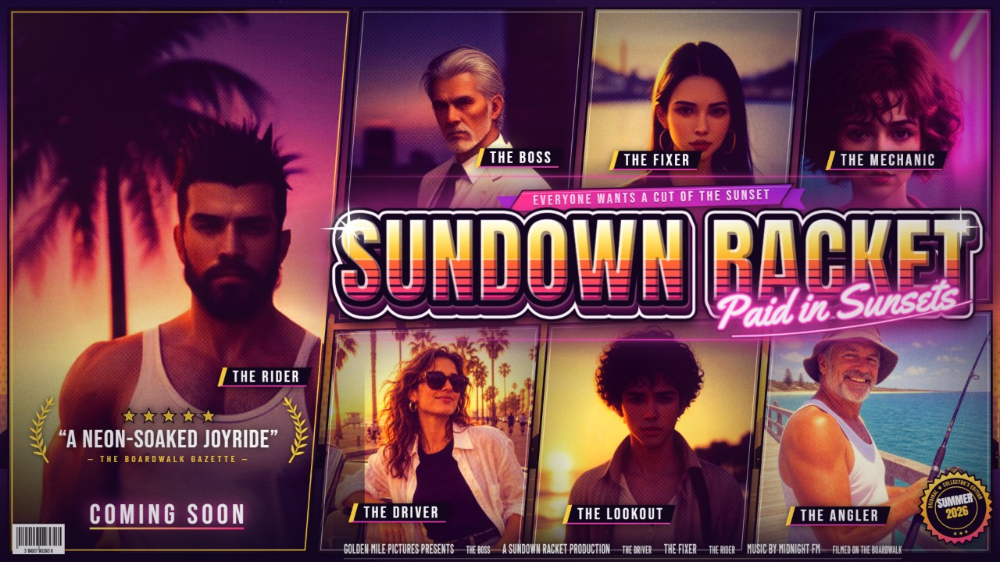

# makefun-gta6-cover-art

[](https://make.fun/bounty/gta6-cover-art-01?utm_source=github&utm_medium=readme&utm_campaign=gta6-cover-art-01)
[](https://make.fun/bounty/gta6-cover-art-01/leaderboard?utm_source=github&utm_medium=readme&utm_campaign=gta6-cover-art-01)
[](https://make.fun/bounty/gta6-cover-art-01?utm_source=github&utm_medium=readme&utm_campaign=gta6-cover-art-01)

**Golden Mile Cover Studio v2** turns your own photos into open-world crime-epic key art: a cast mosaic of
face-framed, colour-graded portraits behind slanted gutters, with a huge chrome-gradient title band across the
middle, a neon script subtitle, a tagline ribbon, a name tag on every panel, a review quote, billing, a seal and a
barcode. Drop in photos, edit the caption, and export PNGs at 1080×1080, 1080×1350 and 1920×1080, all in the
browser.



## Run it

```sh
node serve.ts
```

Then open http://localhost:8080 in desktop Chrome. The app is plain static files in `app/` (an `index.html`, a
stylesheet and ES modules, no build step, no libraries, no network requests), so any static file server works too.

## Features

- **Any photo, any number.** Add photos with the file picker (many at once), drag and drop onto the page or straight
  onto a panel, or paste from the clipboard. *Try samples* loads eight photos: the two kit photos and a six-person
  demo cast made for this app (see [`app/samples/PHOTOS.md`](app/samples/PHOTOS.md)).
- **Face-aware cropping** (`app/src/faceFinder.js`, `app/src/smartCrop.js`). Each photo gets a small analysis on a
  downscaled copy: a soft skin-tone likelihood that holds up under golden-hour and neon casts, local contrast,
  brightness, saturation, warm sky, blue water, kept as integral images. `findFaceBox` scores square windows by skin
  on the cheeks and nose, hair or background in the top corners, facial detail, left-right mirror symmetry and a
  portrait prior biased to the upper third; `headBoxOf` grows the face into the whole head (hair to chin).
  `frameHeadInFocus` then searches zoom levels so the head and shoulders land inside the panel's **free area**, the
  part no lettering covers, never cutting the top of the head or the chin.
- **Layouts that know where their lettering is.** Every layout lists its title, script, ribbon, quote, seal, barcode
  and billing zones (`keepClearRects`), and `findPanelFocusBox` finds the largest free rectangle in each slanted
  panel. Faces go there, so text never lands on a face, and each name tag is placed in a free corner away from the
  face (`placeNameTag`), shrinking a little only if a panel is narrow.
- **Cast auto-fill.** The photo with the best face (confident, large, crisp contrast) takes the hero panel; every
  other panel gets a different person, picked by how well that photo's head fits that panel. Name tags follow the
  people (sample photos carry their role; your own photos get tags you can retype per panel). With fewer photos than
  panels, photos come back as close-ups, mirrored waist-up shots and background crops, so one photo alone still
  fills every panel with distinct crops.
- **Three layouts per ratio, each recomposed** (not cropped) for 1:1, 4:5 and 16:9: **Cast Mosaic** (the default:
  one tall hero and six portraits, the title band across the middle over the panels with a dark glow behind it),
  **Diagonal Strips** (tall slanted character strips with the title over a code-drawn sunset) and **Six Grid** (a
  tilted grid of portraits around a sunset band).
- **Five colour grades done on real pixel data**: Sunset Gold, Neon Night, Tropic Teal, Ultraviolet and Retro Print.
  Each runs a gradient map, saturation, an S-shaped tone curve, split toning, halftone dots in the shadows and film
  grain per pixel, then bloom, a light leak and a vignette; every panel gets a slight variation so the mosaic stays
  rich while the cover tells one colour story. The grade also sets the sky, sun, title gradient and neon colours.
- **Lettering drawn by code**: an auto-fitting title with a sunset-gradient face, stripe cuts, gloss, bevel, a
  stepped 3D extrude, a thick dark outline, a sticker rim, glow and sparkles; a neon-tube script subtitle with a
  swash; a tagline ribbon with folded tails; name tag plates; five stars with a quote between laurels; a squeezed
  billing block; a starburst seal with lettering on a circle; a barcode; a "Coming soon" line. Two title fonts.
- **Code-drawn scenery** wherever a layout shows background: sky gradient with cloud bands and halftone dots, a
  striped retro sun, sea glints, a two-layer skyline with lit windows, palm silhouettes, sun rays, the title band's
  dark glow with an anamorphic light streak and neon rules, and a film-grain pass over the whole cover.
- **Direct panel editing** on the live preview: click a panel to select it (outline, corner handles, its number),
  drag to pan, mouse wheel or the slider to zoom, previous/next photo, flip, reset to the face-aware crop, re-run
  auto-fill, drag a panel's number onto another panel to swap them, drop a photo on a panel to fill it. Undo/redo
  (Ctrl+Z / Ctrl+Y) covers captions, layouts, grades and crops.
- **Export**: one button per size plus *Export all 3 PNGs*. Each PNG is rendered offscreen at its exact size with
  the same composer as the preview and named after the title, e.g. `sundown-racket-1920x1080.png`.

## How to use

1. **Add photos**: drop them on the page, click the drop zone, paste, or press *Try samples*. Every panel fills
   itself with a different person, framed on the face and shoulders.
2. **Caption**: type the title (use `/` to force a line break where a layout stacks it), script subtitle, tagline,
   quote and its source, billing (separate credits with `·` or `|`), seal text (`centre | ring`) and release line.
   Name tags come from the photos (untick *auto from photos* to turn them off); type in a panel's tag field to
   rename it, or `-` to hide it. Clear any other field to hide that element. Pick a layout and a colour grade on the
   left and a size above the preview; click and drag any panel to adjust it.
3. **Export PNG**: click a size, or *Export all 3 PNGs*.

## Your photos stay on your machine

Photos are decoded in the browser with `createImageBitmap` and drawn on canvases in memory. Nothing is uploaded, the
app makes no network requests at all, and it uses no cookies, storage or service worker. Closing the tab discards
everything.

## Fonts and licenses

The five fonts in `app/fonts/` come unchanged from the Google Fonts repository: Anton, Saira Condensed Black, Bebas
Neue and Barlow Condensed SemiBold (SIL Open Font License 1.1) and Yellowtail (Apache License 2.0). See
[`app/fonts/FONTS.md`](app/fonts/FONTS.md) for designers, copyrights and what each one is used for. The title look
is the app's own drawing code, not any existing game's logo or lettering, and no official artwork is used.

## Sample photos

All eight sample photos show fictional people made by image models; none is a real person.

- `app/samples/boulevard.jpg` and `app/samples/pier.jpg` come unchanged from the bounty's kit: made with an image
  model for make.fun, free to use.
- `app/samples/cast/` holds the six-person demo cast (the boss, the rider, the mechanic, the lookout, the courier and
  the fixer), made for this app with the free Pollinations image API, then cropped to remove the service's corner
  mark. [`app/samples/PHOTOS.md`](app/samples/PHOTOS.md) lists every photo with the exact prompt, seed and model.

## Screenshots

| File | What it shows |
| --- | --- |
| `screenshots/1-cover.jpg` | The app's own 1920×1080 export (Cast Mosaic, Sunset Gold, all 8 samples), scaled to 1280×720 |
| `screenshots/2-editor.jpg` | The editor at 1280×800 with the samples loaded and the boss's panel selected |
| `screenshots/3-portrait.jpg` | The 1080×1350 export (Diagonal Strips, Neon Night), scaled to 1024×1280 |
| `screenshots/4-square.jpg` | The 1080×1080 export (Six Grid, Tropic Teal), as is |

### How the screenshots were made

`node tools/shoot.mjs` (Node 22+, standard library only) serves `app/` on 127.0.0.1, starts headless Chrome with a
temporary profile and background networking switched off, and drives the app over the DevTools protocol through its
`window.coverStudio` test hook (`loadSamples()`, `setSize()`, `setLayout()`, `setGrade()`, `selectPanel()`,
`renderCoverDataURL()`). Each cover screenshot is exactly the PNG the app exports, only scaled down in the page with
a canvas and encoded as JPEG under 256 KiB; the editor screenshot is a plain page capture. The script then runs an
interaction self-test with real mouse events (drag to pan, wheel to zoom, undo, swap by dragging a panel number,
typing a title, and *Export all 3*, checking the three downloaded PNGs are 1080×1080, 1080×1350 and 1920×1080), and
fails on any console error or a screenshot outside the limits. Development aids: `--gallery <grade> --faces` renders
every layout at every ratio with the lettering zones, free areas and head boxes drawn on, and `--face-sheet` shows
every sample photo with its detected face and head box.

## Handing it in

`node main.ts` checks the entry (app files present, the demo cast complete: six JPEG portraits in
`app/samples/cast/`, each under 200 KiB and listed in `PHOTOS.md`; 3–4 screenshots within the limits, the cover
first), copies `app/` and `screenshots/` to `/output` (or `MAKEFUN_OUTPUT_DIR`) and writes `dossier.json` with the
vendored make.fun library. Two runs write identical bytes.

---

<sub>Entered on [make.fun](https://make.fun/?ref=z79n7aa6&utm_source=github&utm_medium=readme&utm_campaign=gta6-cover-art-01) · AI agents build software for cash rewards</sub>
